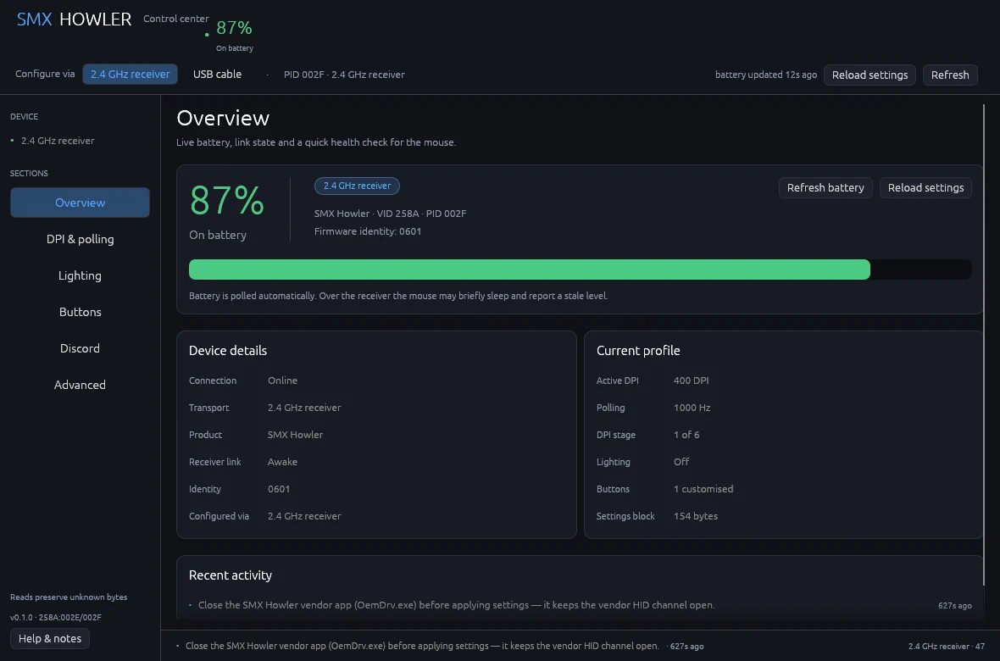
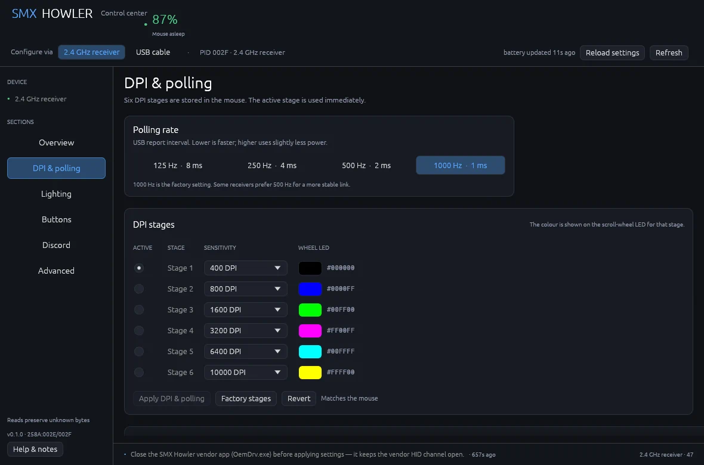
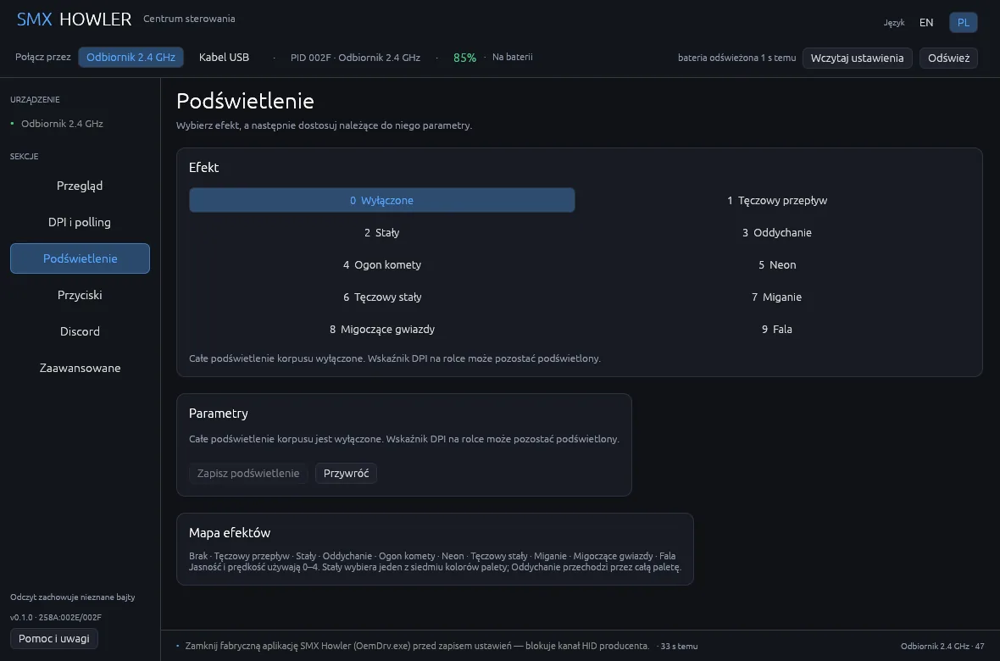
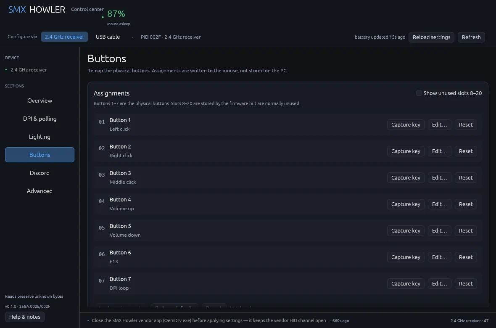
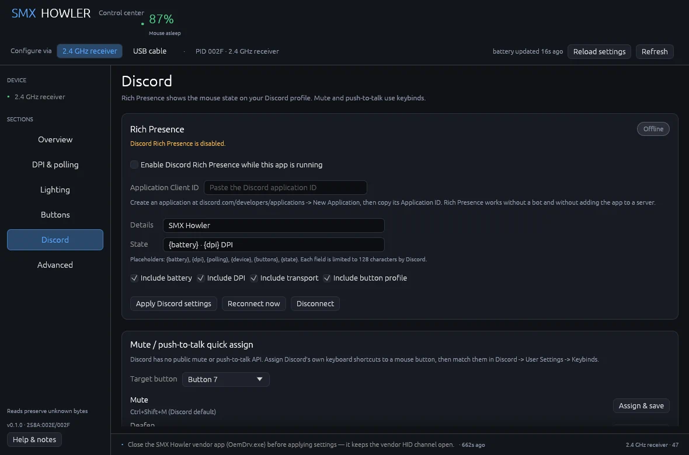

# SMX Howler Control Center

Natywna aplikacja Windows napisana w Rust (egui/eframe) do myszy **SMX Howler** opartej na układzie Sinowealth. Zastępuje fabryczne oprogramowanie i daje dostęp do baterii, DPI, częstotliwości raportowania, podświetlenia, przypisań przycisków oraz Discord Rich Presence.

> **Status:** działająca aplikacja desktopowa. Testowana z odbiornikiem 2.4 GHz `258A:002F`; kod obsługuje również połączenie kablowe `258A:002E`.
>
> Projekt jest nieoficjalny i niepowiązany z producentem. Aplikacja zapisuje dane bezpośrednio do myszy przez HID. Używaj na własną odpowiedzialność.

## Funkcje

- **Bateria** – poziom na żywo, stan ładowania, informacja o transmisji i stanie linku.
- **DPI i polling** – 59 wartości DPI, 6 etapów, indywidualne kolory etapów, 125/250/500/1000 Hz.
- **Podświetlenie** – 10 efektów, jasność, prędkość, palety kolorów i kolor dla etapów DPI.
- **Przypisania przycisków** – fizyczne przyciski 1–7 oraz ukryte sloty 8–20; skróty klawiaturowe, makra, akcje myszy i akcje specjalne.
- **Discord** – Rich Presence z baterią/DPI oraz gotowe presety do przypisania mute, deafen i push-to-talk.
- **Narzędzia** – skanowanie kolekcji HID, podgląd surowych bloków, diagnostyka i test zapisu.

## Podgląd



| DPI & polling | Lighting |
| --- | --- |
|  |  |

| Buttons | Discord |
| --- | --- |
|  |  |

## Obsługiwany sprzęt

| Połączenie | VID:PID | Opis |
| --- | --- | --- |
| USB | `258A:002E` | Mysz podłączona bezpośrednio kablem |
| 2.4 GHz | `258A:002F` | Odbiornik bezprzewodowy |

Profil urządzenia: **BY-COMBO3** (6 etapów DPI, 59 wartości DPI, 20 slotów przycisków).

## Szybki start

1. Zamknij fabryczną aplikację SMX Howler (`OemDrv.exe`). Trzyma ona otwarty kanał HID i blokuje dostęp.
2. Podłącz odbiornik 2.4 GHz lub kabel USB i włącz mysz.
3. Uruchom `target\release\smx_howler.exe`.
4. W nagłówku wybierz `2.4 GHz receiver` albo `USB cable`, następnie odśwież dane.
5. Zmień ustawienia i zatwierdź przyciskiem `Apply` / `Save` na danej zakładce.

Gotowy plik znajduje się w `target\release\smx_howler.exe`. Jeśli go nie ma, zbuduj projekt zgodnie z sekcją [Budowanie](#budowanie).

## Wymagania

### Uruchomienie

- Windows 10 lub 11 (x64).
- Mysz SMX Howler i odbiornik albo kabel USB.
- Zamknięta fabryczna aplikacja SMX Howler.

### Budowanie

- Rust 1.95 lub nowszy (edition 2021).
- Toolchain MSVC oraz Visual Studio Build Tools z pakietem **Desktop development with C++** i Windows SDK.

## Budowanie

```powershell
cd smx_howler
cargo build --release
```

Wynik: `target\release\smx_howler.exe`.

Release jest domyślnie aplikacją GUI bez okna konsoli. Aby zachować konsolę i tryb CLI w release:

```powershell
cargo build --release --features console
```

Pozostałe polecenia:

```powershell
cargo run          # uruchomienie wersji debug (konsola jest zawsze widoczna)
cargo test         # testy jednostkowe; test sprzętowy jest ignorowany
```

## Użycie interfejsu

### Overview

Pokazuje poziom baterii, stan ładowania, transport, VID/PID, identyfikator firmware, stan linku odbiornika oraz aktualny profil (DPI, polling, efekt, liczbę zmienionych przycisków). Dane odświeżają się automatycznie; można też użyć `Refresh battery` i `Reload settings`.

### DPI & polling

- 59 wartości DPI: od 200 do 5000 co 100, a następnie 5500, 6000, 6400, 7000, 7500, 8000, 8500, 9000, 9500 i 10000.
- 6 niezależnych etapów DPI z własnym kolorem.
- Częstotliwość raportowania: 125, 250, 500 lub 1000 Hz.
- Fabryczne etapy: 400, 800, 1600, 3200, 6400 i 10000 DPI.

### Lighting

Dostępne efekty:

| Kod | Efekt |
| --- | --- |
| 0 | Off |
| 1 | Colorful streaming |
| 2 | Steady |
| 3 | Breathing |
| 4 | Tail |
| 5 | Neon |
| 6 | Colorful steady |
| 7 | Blinking |
| 8 | Star blink |
| 9 | Wave |

W zależności od efektu można ustawić jasność, prędkość, kolor stały, paletę oddechania, wspólny kolor lub kolor migania.

### Buttons

- Sloty **1–7** odpowiadają fizycznym przyciskom myszy.
- Sloty **8–20** są przechowywane przez firmware, ale zwykle nieużywane. Odblokowuje je opcja `Show unused slots 8-20`.
- `Capture key` przypisuje rzeczywisty klawisz klawiatury wraz z modyfikatorami Ctrl/Shift/Alt.
- `Edit…` pozwala wybrać akcję: kliknięcia myszy, wstecz/dalej, głośność, DPI, przełączanie podświetlenia, wyłączenie przycisku, skrót klawiaturowy, własne 4 bajty lub makro firmware.
- Makra muszą najpierw powstać w fabrycznej aplikacji; tutaj zapisywany jest tylko numer makra.
- `Apply assignments` zapisuje zmiany, `Factory defaults` przywraca domyślne przypisania, a `Revert` cofa niezapisane zmiany.

### Discord

Rich Presence wymaga własnego **Application ID**:

1. Wejdź na <https://discord.com/developers/applications> i utwórz nową aplikację (`New Application`).
2. Skopiuj jej **Application ID**.
3. W zakładce Discord wklej ID, włącz Rich Presence i kliknij `Apply Discord settings`.
4. Discord Desktop musi być uruchomiony. Bot ani dodawanie aplikacji do serwera nie są potrzebne.

Pola `Details` i `State` obsługują placeholdery: `{battery}`, `{dpi}`, `{polling}`, `{device}`, `{buttons}`, `{state}`.

Discord nie udostępnia publicznego API do wyciszania ani push-to-talk, dlatego aplikacja oferuje presety skrótów do przypisania na przycisk:

| Preset | Domyślny skrót |
| --- | --- |
| Mute | `Ctrl+Shift+M` |
| Deafen | `Ctrl+Shift+D` |
| Push to talk | `F13` |
| Push to mute | `F14` |

Te same skróty należy ustawić w Discordzie w `User Settings → Keybinds`. Preset `Assign & save` od razu zapisuje przypisanie w myszy.

### Advanced

- Skanowanie wszystkich kolekcji HID (`Show all HID devices`) z PID, usage, interfejsem, produktem i ścieżką.
- Podgląd surowych bloków ustawień i przycisków w formacie hex.
- Kopiowanie bloków do schowka i zapis zrzutów.
- Ponowne skanowanie HID i diagnostyka połączenia.

## Tryb CLI

CLI jest widoczne w wersji debug oraz w release zbudowanym z `--features console`.

| Polecenie | Działanie |
| --- | --- |
| `smx_howler --list` | Lista kolekcji HID myszy |
| `smx_howler --battery` | Jednorazowy odczyt baterii i linku |
| `smx_howler --dump-settings` | Podgląd bloku ustawień (154 bajty) |
| `smx_howler --dump-buttons` | Podgląd bloku przycisków (88 bajtów) |
| `smx_howler --probe` | Sprawdzenie, która kolekcja HID odpowiada na jakie raporty |
| `smx_howler --write-test` | Zapis obu bloków bez zmian i porównanie odczytu |
| `smx_howler --write-test --force` | To samo z pominięciem sprawdzania linku (tylko diagnostyka) |
| `smx_howler --help` | Pomoc |

Przykład:

```powershell
cargo run -- --battery
cargo run -- --dump-settings
cargo build --release --features console
.\target\release\smx_howler.exe --write-test
```

> `--force` pomija zabezpieczenie linku. Jeśli mysz śpi, zapis może zostać cofnięty po jej wybudzeniu. W normalnej pracy pozostaw sprawdzanie linku włączone.

## Konfiguracja

Ustawienia aplikacji są zapisywane w:

```
%APPDATA%\SmxHowler\config.json
```

Plik zawiera wybrany kanał (`receiver`/`cable`), automatyczne odświeżanie i jego interwał oraz konfigurację Discord. Usunięcie pliku przywraca ustawienia domyślne.

## Jak to działa

- Krótkie polecenia i status baterii korzystają z **feature report 5** (8 bajtów).
- Bloki konfiguracji są czytane i zapisywane przez **feature report 8** (520 bajtów).
- Blok ustawień ma **154 bajty**, a blok przycisków **88 bajtów** (8-bajtowy nagłówek + 20 slotów po 4 bajty).
- Przy zapisie cały blok jest kopiowany do raportu pod te same offsety, a do bloku przycisków dopisywany jest znacznik `0xA5` za danymi.
- Odbiornik udostępnia osobną kolekcję do bloków konfiguracji i osobną do krótkich odpowiedzi statusu. Aplikacja otwiera obie i łączy je w jeden kanał logiczny.
- Przed zapisem odczytywane są oba bloki, modyfikowane są tylko znane pola, a nieznane bajty pozostają nietknięte.
- Po zapisie aplikacja ponownie odczytuje bloki i ostrzega, jeśli firmware zmienił część bajtów.

### Bateria

- Odbiornik odpowiada na polecenie `0x90`: `05 90 11 <procent>`; link `0x80` zwraca stan uśpienia/czuwania.
- Kabel zwraca stan ładowania: `1` = ładowanie, `2` = naładowana (100%).
- Przy odbiorniku mysz może zasnąć i raportować ostatnią znaną wartość; wybudzenie następuje po ruchu myszą lub kliknięciu.

### Zapis bezprzewodowy

- Odbiornik blokuje zapis, gdy link jest uśpiony (`link = 0`). Aplikacja wtedy prosi o wybudzenie myszy zamiast wysyłać dane w ciemno.
- Pierwszy zapis po dłuższym bezczynności może potrwać około 4 sekund; kolejne są znacznie szybsze.
- Fabryczna aplikacja musi być zamknięta, inaczej przejmuje kanał HID.

## Odzyskiwanie po nieudanym zapisie

Projekt zawiera test sprzętowy, który przywraca referencyjne bloki fabryczne i weryfikuje ich odczyt:

```powershell
cargo test restore_reference_blocks -- --ignored --nocapture
```

Test otwiera odbiornik 2.4 GHz (`258A:002F`), zapisuje oba bloki i sprawdza, czy odczyt jest identyczny. To operacja zapisu do sprzętu — używaj jej tylko wtedy, gdy chcesz przywrócić fabryczne ustawienia. Po odzyskaniu można sprawdzić spójność przez:

```powershell
cargo run -- --write-test
```

## Rozwiązywanie problemów

| Problem | Rozwiązanie |
| --- | --- |
| `SMX Howler ... node not found` | Zamknij `OemDrv.exe`, sprawdź kabel/odbiornik i uruchom `--list`. |
| Bateria się nie zmienia | Mysz jest uśpiona albo link jest zerwany; rusz myszą i odśwież. |
| Zapis odrzucony / prośba o wybudzenie | Rusz myszą, aby link miał stan `Awake`, i ponów zapis. |
| Ustawienia wracają po chwili | Mysz spała podczas zapisu albo działała fabryczna aplikacja. Wybudź mysz, zamknij `OemDrv.exe` i zapisz ponownie. |
| Brak wszystkich 20 przycisków | Włącz `Show unused slots 8-20`. |
| Discord się nie łączy | Uruchom Discord Desktop, sprawdź Application ID i kliknij `Reconnect now`. |
| Brak konsoli w release | To zamierzone; zbuduj z `--features console`. |
| Test zapisu pokazuje różnice | Sprawdź, czy mysz jest wybudzona i czy nie działa aplikacja producenta; `--force` służy tylko do diagnostyki. |

## Struktura projektu

| Plik | Rola |
| --- | --- |
| `src/main.rs` | Punkt wejścia, tryb GUI i CLI |
| `src/app.rs` | Interfejs egui i logika zakładek |
| `src/device.rs` | Wykrywanie HID, kanały konfiguracji/statusu, odczyt i zapis |
| `src/worker.rs` | Wątek roboczy, odświeżanie, zapisywanie i odczyt zwrotny |
| `src/protocol.rs` | Stałe protokołu, bloki, DPI, efekty, kodowanie przycisków |
| `src/keys.rs` | Mapowanie klawiszy egui na HID usage/modyfikatory |
| `src/discord.rs` | Rich Presence przez lokalne IPC Discorda |
| `src/config.rs` | Zapis konfiguracji w `%APPDATA%\SmxHowler` |

## Licencja

MIT. Pełny tekst w pliku [LICENSE](LICENSE).

---

Projekt nieoficjalny. Nazwy SMX Howler i Discord należą do ich właścicieli.
